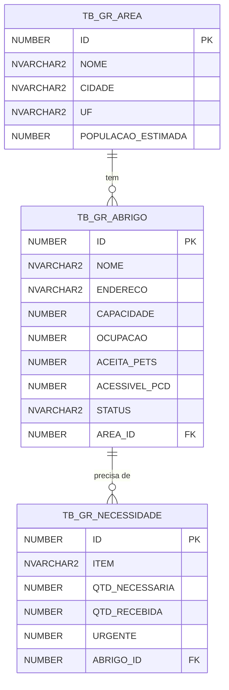

# GuardaRio · Módulo de Abrigos (.NET)

> Global Solution 2026/2 · CitizenTech · Advanced Business Development with .NET

## Integrantes

| Nome | RM |
|---|---|
| Henrique Spoltore Moreno Pavão dos Santos | RM568130 |
| Raphael Oliveira Sinelli Mendonça | RM568346 |
| Arthur Lins Belarmino | RM566845 |

## Descrição da solução

O **GuardaRio** é uma CitizenTech de alerta antecipado de enchentes para moradores de áreas ribeirinhas e de baixada. Estações IoT medem o nível do rio e a chuva, acionam uma sirene local mesmo sem internet e enviam as leituras para a nuvem, que gera alertas para a área.

Esta API é o **Módulo de Abrigos da Defesa Civil**: cadastra as áreas de risco, os abrigos de cada área (capacidade, ocupação, se aceita pets, se é acessível para PcD) e as necessidades de doação de cada abrigo. É essa informação que responde à pergunta de quem precisa sair de casa: *qual abrigo tem vaga e aceita o meu cachorro?*

**Regra de negócio principal (RN05):** a ocupação nunca passa da capacidade. Quando chega ao limite, o status do abrigo vira `LOTADO` sozinho; quando libera vaga, volta a `ABERTO`. Um abrigo `FECHADO` não pode ter pessoas. A regra é validada na API (400) e também por uma *check constraint* no Oracle.

**Relação com as outras entregas:** o app Flutter e a API Java (que roda em containers na Azure na entrega de DevOps) cuidam do cidadão, das estações e dos alertas. Este módulo cuida da gestão administrativa dos abrigos, usando o Oracle da FIAP, e as necessidades de doação alimentam a futura tela "Como ajudar" do app.

## Diagrama das entidades



- **AreaRisco 1:N Abrigo** com `DeleteBehavior.Restrict`: não dá para apagar uma área que ainda tem abrigos (409).
- **Abrigo 1:N NecessidadeAbrigo** com `DeleteBehavior.Cascade`: ao apagar o abrigo, as necessidades dele vão junto.

## Tecnologias

- ASP.NET Core 8 (Web API com controllers)
- Entity Framework Core 8 com o provider `Oracle.EntityFrameworkCore`
- Oracle da FIAP (`oracle.fiap.com.br`), tabelas criadas **somente por Migrations**

## Estrutura

```
Controllers/   AreasController, AbrigosController, NecessidadesController
Data/          GuardaRioContext (DbContext + mapeamento das tabelas)
Dtos/          Requests com validação e Responses
Models/        Entidades AreaRisco, Abrigo, NecessidadeAbrigo
Migrations/    Migrations do EF Core (versionadas)
GuardaRio.Abrigos.http   Roteiro de testes
```

## Como executar

Pré-requisitos: [.NET SDK 8](https://dotnet.microsoft.com/download/dotnet/8.0) e acesso ao Oracle da FIAP.

```bash
# 1. Clonar e entrar na pasta
git clone <URL_DO_REPOSITORIO>
cd guardario-dotnet

# 2. Instalar a ferramenta do EF Core (uma vez por máquina)
dotnet tool install --global dotnet-ef --version 8.0.11

# 3. Restaurar os pacotes
dotnet restore

# 4. Configurar a conexão com o Oracle FORA do repositório (user-secrets)
dotnet user-secrets set "ConnectionStrings:Oracle" "User Id=RM000000;Password=SUA_SENHA;Data Source=oracle.fiap.com.br:1521/ORCL"

# 5. Criar as tabelas no Oracle aplicando as Migrations
dotnet ef database update

# 6. Subir a API (http://localhost:5080)
dotnet run
```

> A senha nunca fica no `appsettings.json`. Como alternativa ao user-secrets, use a variável de ambiente `ConnectionStrings__Oracle`.

Para conferir as tabelas no SQL Developer:

```sql
SELECT * FROM TB_GR_AREA;
SELECT * FROM TB_GR_ABRIGO;
SELECT * FROM TB_GR_NECESSIDADE;
```

## Endpoints

| Método | Rota | Sucesso | Erros |
|---|---|---|---|
| GET | `/api/areas` | 200 | |
| GET | `/api/areas/{id}` | 200 | 404 |
| POST | `/api/areas` | 201 | 400 |
| PUT | `/api/areas/{id}` | 204 | 400, 404 |
| DELETE | `/api/areas/{id}` | 204 | 404, 409 (área com abrigos) |
| GET | `/api/abrigos?areaId=&aceitaPets=&acessivelPcd=&somenteComVaga=` | 200 | |
| GET | `/api/abrigos/{id}` | 200 | 404 |
| GET | `/api/abrigos/{id}/necessidades` | 200 | 404 |
| POST | `/api/abrigos` | 201 | 400 |
| PUT | `/api/abrigos/{id}` | 204 | 400, 404 |
| DELETE | `/api/abrigos/{id}` | 204 | 404 |
| GET | `/api/necessidades?abrigoId=&urgente=` | 200 | |
| GET | `/api/necessidades/{id}` | 200 | 404 |
| POST | `/api/necessidades` | 201 | 400 |
| PUT | `/api/necessidades/{id}` | 204 | 400, 404 |
| DELETE | `/api/necessidades/{id}` | 204 | 404 |

## Como testar

O arquivo **`GuardaRio.Abrigos.http`** tem o roteiro completo, na ordem: cria área, abrigo e necessidade, atualiza, testa os erros e apaga tudo. Abra no VS Code com a extensão *REST Client*, no Visual Studio ou no Rider e clique em *Send Request* em cada bloco.

Também dá para testar com curl:

```bash
# Criar área -> 201
curl -i -X POST http://localhost:5080/api/areas \
  -H "Content-Type: application/json" \
  -d '{"nome":"Jardim Pantanal","cidade":"São Paulo","uf":"SP","populacaoEstimada":45000}'

# Criar abrigo -> 201
curl -i -X POST http://localhost:5080/api/abrigos \
  -H "Content-Type: application/json" \
  -d '{"nome":"EMEF Jardim Pantanal","endereco":"Rua das Garças, 120","capacidade":120,"ocupacao":30,"aceitaPets":true,"acessivelPcd":true,"fechado":false,"areaRiscoId":1}'

# POST inválido -> 400 (ocupação maior que a capacidade)
curl -i -X POST http://localhost:5080/api/abrigos \
  -H "Content-Type: application/json" \
  -d '{"nome":"Teste","endereco":"Rua X, 1","capacidade":10,"ocupacao":50,"areaRiscoId":1}'

# Id inexistente -> 404
curl -i http://localhost:5080/api/abrigos/999
```

Exemplos de resposta de erro:

```json
// 400 - validação (gerado pelo [ApiController])
{
  "type": "https://tools.ietf.org/html/rfc9110#section-15.5.1",
  "title": "One or more validation errors occurred.",
  "status": 400,
  "errors": {
    "Ocupacao": ["A ocupação não pode ser maior que a capacidade do abrigo."]
  }
}

// 404
{ "mensagem": "Abrigo 999 não encontrado." }
```

## Vídeo

Link: <COLOCAR_LINK_DO_YOUTUBE>